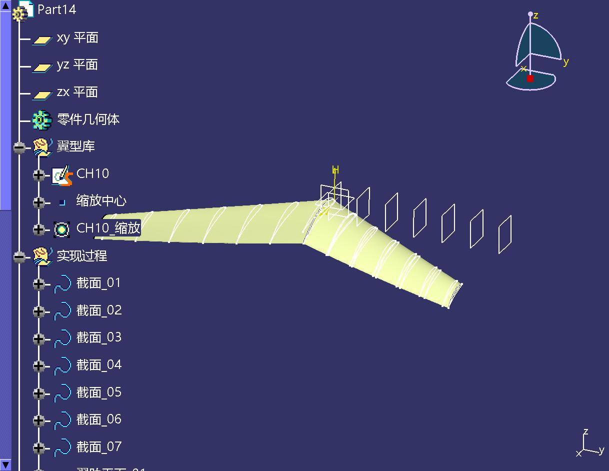

# CATIA Wing Tool · CATIA 机翼参数化建模

> Generate a parametric aircraft wing inside **CATIA V5** from a handful of engineering
> parameters — via a small desktop GUI or a Python/pycatia script.
> 用一组工程参数在 CATIA V5 里自动生成参数化机翼。

Input an airfoil `.dat` plus root chord, span, quarter-chord sweep, taper ratio, incidence and
geometric twist → get a closed design tree with `Parameters / Relations / Airfoil library /
Construction / Wing / Ribs / Pose`, optionally sliced rib sections, symmetry, and XYZ
rotation/translation that stay editable (formula-driven) inside CATIA.

**Quick links:** [快速开始](快速开始.md) ·
[中文说明书](使用说明.md) ·
[安装指南（中文）](文档/环境安装指南.md) ·
[Installation Guide (English)](INSTALL.en.md) ·
[Releases](https://github.com/Zzzyyxx/catia-wing-tool/releases)



---

## 快速开始（30 秒）

> 更短的版本见 **[快速开始.md](快速开始.md)**；换电脑装环境见 **[INSTALL.en.md](INSTALL.en.md)**。

```text
1. 解压到纯英文路径（如 D:\CATIA_Wing_Tool）   ※ CATIA 的 SaveAs 不支持中文路径
2. 双击 启动器.bat
3. 点「导入 .dat」→ 选 airfoils\CH10.dat
4. 参数保持默认：弦长 100 / 展长 500 / 后掠 30° / 梢根比 0.45 / 安装角 10° / 扭转 10° / 截面 7
5. 点「⚡ 生成机翼模型」→ 切到 CATIA 看设计树
```

命令行也支持：

```bat
python wing_builder.py --config configs\example_basic.json
python wing_builder.py --config configs\example_basic.json --dry-run
```

---

## 环境要求（换电脑必看）

| 项 | 值 |
|---|---|
| 系统 | Windows |
| CAD | **CATIA V5**（能正常启动，且 COM 已注册 `CATIA.Application`） |
| Python | **3.11**（3.13/3.14 目前装不上 `pywin32` 轮子）；**位数要与 CATIA 一致**（64 位 CATIA → 64 位 Python） |
| 依赖 | `pycatia`（0.10.x，会自带 `pywin32`） |

### 三种装法，任选其一

**① 一键脚本（已有 conda 时最省事）**

```text
双击 工具\安装环境.bat
```

自动建 `catia311` 环境 → 装 pycatia（清华镜像）→ 设 `CATIA_PY` → 跑自检。

**② conda 手动（3 条命令）**

```bat
conda create -n catia311 python=3.11 -y
conda activate catia311
python -m pip install pycatia
```

**③ 官方 Python + venv（不想装 Anaconda）**

```bat
python -m venv .venv
.venv\Scripts\activate
python -m pip install pycatia
setx CATIA_PY "%CD%\.venv\Scripts\python.exe"
```

> 装在别处时，用 `setx CATIA_PY "<那个 python.exe 的完整路径>"` 告诉启动器（新开终端生效）。
> 启动器查找顺序：`CATIA_PY` → `%USERPROFILE%\anaconda3\envs\catia311` → `%ProgramData%\anaconda3\...` → PATH 上的 `python`。

### 验证

双击 **`工具\环境检查.bat`**：依次检查解释器版本、`pycatia` 导入、CATIA 连接、
建 Part / 建点 / 多截面曲面 / 知识工程参数。全绿即可用。

> 不需要手动先开 CATIA —— 程序通过 COM 拉起（冷启动约 15 秒）。
> 完整安装步骤、常见报错（`无效的类字符串`、`服务器运行失败`、pywin32 编译失败等）
> 见 **`文档/环境安装指南.md`**。

---

## 目录结构

| 路径 | 说明 |
|---|---|
| `启动器.bat` | 双击启动（自动寻找 Python 3.11 + pycatia） |
| `launcher.py` | 图形界面：导入翼型 → 填参数 → 生成 → 实时日志 / 俯视预览 |
| `wing_builder.py` | 建模核心：参数与公式、翼型解析、截面、多截面曲面、翼肋、对称与姿态 |
| `使用说明.md` | 详细说明书（界面、数据格式、报错对照、JSON 字段、限制） |
| `airfoils/` | 翼型库：`CH10.dat`（XFLR5 三列格式示例）、`NACA0018.dat` |
| `configs/` | 示例配置：`example_basic` / `example_with_ribs` / `example_pose` |
| `output/` | 生成的 `.CATPart` 与截图（含示例成品） |
| `文档/` | **环境安装指南**、接口实测与可行性分析、参考视频的建模流程笔记 |
| `工具/` | 安装环境脚本、环境检查脚本、两个 CATIA 自动化探针 |
| `logs/` | 运行日志（每次生成自动写入，已 gitignore） |

---

## 设计树长什么样

```
参数      翼型选择器 / 翼根弦长 / 翼展展长 / 后掠角 / 几何扭转 / 梢根比 / 展弦比 / 安装角
          + 对称开关 / 绕X·Y·Z旋转 / 平移X·Y·Z
关系      展弦比公式、翼型缩放公式、姿态类公式…
翼型库    以文件名命名的草图 + 缩放（比率由 翼根弦长 驱动）
实现过程  截面_01…NN（多截面路线）/ 前缘·后缘引导线 + 脊线（扫掠路线）
机翼      多截面曲面（或扫掠）
翼肋      顺气流截面 + 镜像（可选）
姿态与定位 对称 / X·Y·Z 轴 / 旋转Z·Y·X / 平移X·Y·Z
```

**默认全参数联动**：每个截面都由「基准翼型 + 缩放 + 旋转 + 平移」四个特征生成，
缩放比 / 转角 / 位移全部写成公式。所以在 CATIA 里改
`翼根弦长`、`翼展展长`、`后掠角`、`梢根比`、`安装角`、`几何扭转`、`绕XYZ旋转`、`平移XYZ`
→ `Update` → 整片机翼重建，不用重跑脚本。

实测：`翼根弦长` 100→200 mm 时多截面面积 0.0385 → 0.0768 m²。

### ⚠️ 看不到「参数」节点？先做这一次设置

CATIA 默认隐藏该节点。**工具 → 选项 → 基础结构 → 零件基础结构 → 显示** →
勾选 **「参数」** 和 **「关系」** → 确定。之后设计树里就能双击参数改值，
改完按 `Ctrl+U`（更新）→ 机翼按新参数重建。

（详细图文步骤见 `使用说明.md` 的「一之二」节。）

---

## 支持的翼型文件格式

- 两列 `x y`（Tab / 空格 / 逗号 / 分号分隔）
- **XFLR5 三列 `x  0  z`**（真实厚度在第 3 列，自动识别）
- 带表头 / 注释行（自动跳过）
- 坐标带单位（弦长 > 1.5 自动归一化）
- 首尾重复点、连续重复点（自动去重）
- "蝴蝶结"点序（上表面走完再下表面，自动重排成单环）

---

## 常见问题

| 现象 | 处理 |
|---|---|
| `Bad magic number in .pyc file` | 用错了 Python 版本；删 `__pycache__`，双击 `launcher.py` 会自动切到 3.11 |
| 弹窗「环境不对」 | 解释器不是 3.11 且找不到 conda 环境，改用 `启动器.bat` 或设 `CATIA_PY` |
| 弹窗「阶段「xxx」失败」 | 看弹窗里的提示 + 参数快照；完整日志在 `logs\build_*.log` |
| `方法 SaveAs 失败` | 路径含中文/特殊字符 → 挪到英文路径（工具也有临时文件中转兜底） |
| 生成很慢 | 截面数或翼肋太多（每点一次 COM 调用）：截面 7~11、翼肋间距 ≥ 20 mm |
| 翼肋"位置看着不对" | 那几片薄片是**翼肋平面**（切片基准面），翼肋是贴合翼面的曲线 |

---

## 已知限制

- 可选择**实体化**：自动做「两端封口 → 接合 → 水密壳体」，并在有 Part Design 许可时封闭成实体；
  无许可时保留水密壳体（已可直接用于外流场网格），详见 `使用说明.md` §五之三；
- 曲面质量检查（斑马线 / 曲率梳）仍需人工在 CATIA 里做；
- 改弦长 / 展长 / 梢根比 / 扭转 / 截面数 需要重跑脚本（公式驱动项除外）；
- 依赖 CATIA V5 的 COM 自动化，无法在无 CATIA 的机器上运行；
- 高 DPI 下俯视预览的图形位置可能略偏（观感问题，不影响生成）。

---

## 文档

1. `README.md` —— 本文件
2. `使用说明.md` —— 主说明书
3. `文档/机翼参数化建模_可行性分析.md` —— 技术分析、接口实测数据、踩坑记录、升级路线
4. `文档/NPU-WishYu_建模流程笔记.md` —— 参考视频六集的建模流程提炼与对照

---

## 免责声明

本项目只调用 CATIA 公开的自动化接口，不包含、不修改任何 Dassault Systèmes 组件。
CATIA、pycatia 各自遵循其原始许可。

*本地工具，无遥测；几何全部生成在你自己的 CATIA 里。*
